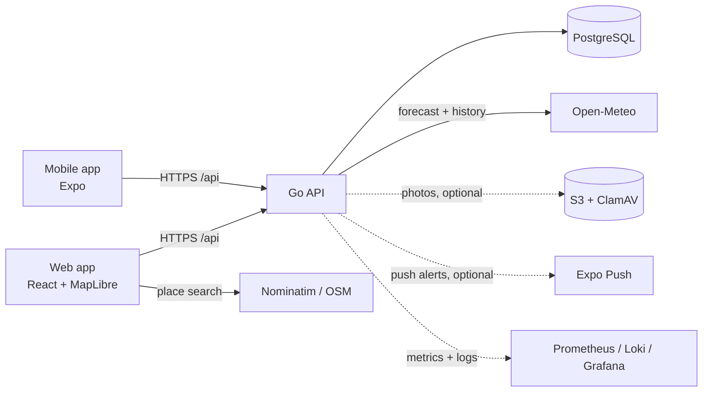

# AuraRisk

[](https://github.com/iochieng1/Aura-Risk/actions/workflows/ci.yml)

AuraRisk is a climate-risk platform providing localized flood predictions, early warnings, and community-driven disaster reporting. By combining weather forecasts, satellite data, geospatial mapping, and citizen insights, it helps communities, governments, NGOs, and businesses proactively prepare for flood events.

> **Decision support only.** AuraRisk is not an official flood warning service, and its risk score is not yet calibrated against observed floods ([#22](https://github.com/iochieng1/Aura-Risk/issues/22)). Always follow local authorities.

**Live demo:** [aurarisk-web.onrender.com](https://aurarisk-web.onrender.com) · API health: [aurarisk-api.onrender.com/health/ready](https://aurarisk-api.onrender.com/health/ready)

_Hosted on free tiers (Render + Neon): the first request after a quiet period can take up to a minute while the server wakes up._

## Highlights

- **Resilient weather data:** Open-Meteo access with grid-cell caching, retries with backoff, a circuit breaker, and a stale-data fallback that is flagged in the UI.
- **Production-minded API (Go):**
  - structured errors with request IDs
  - per-client rate limits
  - versioned migrations
  - graceful shutdown with readiness draining
  - secrets from files or AWS Secrets Manager
- **Observability:** Prometheus metrics, Grafana dashboards, alert rules with runbooks, and JSON logs searchable by request ID in Loki.
- **Community reports:**
  - duplicate detection, automatic verification and moderation
  - retention policies and an audit log
  - XSS-safe rendering
- **Accessible web app (React):** loading, empty, error and offline states; data freshness; and a screen-reader list alternative to the map.
- **Offline-first mobile app (Expo):**
  - cached risk data and a retry queue for reports
  - push alerts with consent and quiet hours
  - secure token storage
  - scanned photo uploads
- **CI on every PR:** formatting, vet, race-detector tests with Postgres, mobile and web builds, monitoring config checks, and dependency scans.

## Architecture



More detail: [docs/ARCHITECTURE.md](docs/ARCHITECTURE.md).

## Roadmap

| Issue | Status | Plan |
|---|---|---|
| [#22 Calibrate the risk score](https://github.com/iochieng1/Aura-Risk/issues/22) | Open: release gate | [docs/RISK_DATA_SOURCES.md](docs/RISK_DATA_SOURCES.md): replace the placeholder terrain factor, add river discharge, backtest against past floods |
| [#18 PostGIS spatial queries](https://github.com/iochieng1/Aura-Risk/issues/18) | Open | Radius search instead of bounding boxes; also stores the terrain layers for #22 |
| [#27 Production deployment](https://github.com/iochieng1/Aura-Risk/issues/27) | Open: release gate | [docs/DEPLOYMENT.md](docs/DEPLOYMENT.md): free demo on Render now (`render.yaml`); AWS or DigitalOcean for a real launch |
| [#26 Tests and CI](https://github.com/iochieng1/Aura-Risk/issues/26) | Mostly done | CI runs on every PR; remaining: require it to pass before merging, and database-failure tests |

How these depend on each other, plus untracked work and the recommended order: [docs/ROADMAP.md](docs/ROADMAP.md).

All issues: [open](https://github.com/iochieng1/Aura-Risk/issues) · [closed](https://github.com/iochieng1/Aura-Risk/issues?q=is%3Aissue+is%3Aclosed)

## Backend setup and run

This project includes a Go backend that exposes weather-risk and community-report APIs. The backend was verified to start successfully with PostgreSQL running locally.

### Prerequisites
- Go 1.27+ (`go.mod` pins 1.27.1; with `GOTOOLCHAIN=auto`, the default, an older `go` downloads it)
- Docker and Docker Compose
- PostgreSQL (provided by the included Compose setup)

### Quick start

1. Start the local Postgres database from the repo root:

```bash
cd /workspaces/Aura-Risk
docker compose up -d postgres
```

2. Configure the backend environment variables. You can either copy the example file or export the values manually:

```bash
cd /workspaces/Aura-Risk
cp .env.example .env
```

Edit `.env` and replace the `change-me-*` placeholders with your own local passwords. Docker Compose reads the same file and refuses to start if `POSTGRES_PASSWORD`, `AWS_ACCESS_KEY_ID`, or `AWS_SECRET_ACCESS_KEY` are missing. The backend has no built-in database URL and exits at startup if `DATABASE_URL` is not set.

See [Secrets and production configuration](docs/ARCHITECTURE.md#secrets-and-production-configuration) for `APP_ENV=production`, mounted secret files, and AWS Secrets Manager.

3. Apply database migrations, then run the backend:

```bash
cd /workspaces/Aura-Risk/aurarisk-backend
go mod tidy
go run . migrate
go run .
```

The server refuses to start while migrations are pending. Run `go run . migrate` again after pulling schema changes, or set `AUTO_MIGRATE=true` in `.env` to apply them at startup. See [Database migrations](docs/ARCHITECTURE.md#database-migrations).

4. Confirm the server is running:

```bash
curl http://localhost:8080/health
```

Expected response:

```json
{"status":"ok"}
```

### API endpoints
- GET `/health` — health check
- GET `/api/risk?lat=...&lon=...` — flood risk assessment
- POST `/api/risk` — flood risk from weather the client fetched from Open-Meteo (`{lat, lon, weather}`); used automatically when GET answers 503
- GET `/api/reports?lat=...&lon=...` — nearby community reports
- POST `/api/reports` — create a new report
- Report moderation, duplicate detection, automatic verification, and retention — see [docs/REPORT_CURATION.md](docs/REPORT_CURATION.md)
- Device accounts, push consent, location subscriptions, and photo uploads — see [docs/MOBILE_PHASE3.md](docs/MOBILE_PHASE3.md)
- Risk model data sources and calibration plan — see [docs/RISK_DATA_SOURCES.md](docs/RISK_DATA_SOURCES.md)
- Production hosting options and deployment checklist — see [docs/DEPLOYMENT.md](docs/DEPLOYMENT.md)

### Monitoring and on-call

`docker compose --profile monitoring up -d` starts Prometheus, Alertmanager, Grafana (http://localhost:3000), a Postgres exporter, and Loki with Alloy for centralized logs. Set `METRICS_ADDR=:9464` in `.env` so Prometheus can scrape the backend, and `LOG_FORMAT=json` with `LOG_FILE=../logs/backend.log` so its logs reach Loki (searchable by `request_id` in Grafana → Explore). Dashboards cover API latency, DB saturation, provider health, and weather data freshness. Alert rules, ownership, escalation, and runbooks are in [docs/ON_CALL.md](docs/ON_CALL.md).

### Verified status
The backend was verified to build and run successfully with the database available. The application logs show:

```text
✅ Database connected
🚀 AuraRisk backend running on port 8080
```

### Troubleshooting
- If PostgreSQL is not reachable, start it again with `docker compose up -d postgres`.
- If the app cannot connect to the database, check that the `DATABASE_URL` matches the local Postgres container. Postgres only applies `POSTGRES_PASSWORD` when it first creates its volume, so an existing `aurarisk_pgdata` volume keeps its old password; either keep using it in `.env` or run `docker compose down -v` to recreate the database.
- If a dependency issue occurs, run `go mod tidy` inside `aurarisk-backend`.

## Web and mobile clients

- `aurarisk-frontend/`: Vite + React web app (`npm install && npm run dev`). It calls the backend through the dev server's `/api` proxy, so start the backend first. Set `VITE_API_BASE_URL` for builds that talk to an API on another origin (and list the app in the backend's `CORS_ALLOWED_ORIGINS`), or `VITE_USE_MOCK_API=true` to work on the UI without a backend. See `aurarisk-frontend/.env.example`.
- `aurarisk-mobile/`: Expo app (`npm install && npx expo start`). Set `EXPO_PUBLIC_API_BASE_URL` to an address the device can reach (for example `http://10.0.2.2:8080` on the Android emulator).
- `packages/shared/`: API types, client, and validation used by both. See [its README](packages/shared/README.md).

The mobile app picks a location from the device's GPS when the user allows it. If permission is denied, blocked, or location services are off, the user can still search for a place or type coordinates.

## Contributing

- Every pull request runs CI (`.github/workflows/ci.yml`): Go formatting, vet, and tests (including Postgres integration tests), the mobile typecheck and tests (which cover `packages/shared`), the web build, and the monitoring config checks.
- Link each PR to its issue. `Closes #N` closes the issue on merge; use `Part of #N` when only some deliverables are done. The PR template has a checklist for this.
- Close issues through PRs rather than by hand, so every closed issue points at the code that implemented it.
