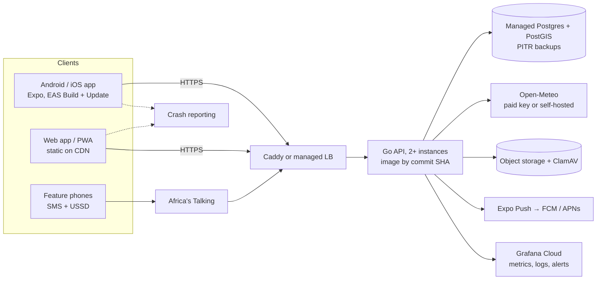

# Production roadmap: from hackathon project to a deployable app

An assessment of the repository as of 2026-11-11 (commit `690f4be`), what it
still needs before it can be run as a real service and installed on a phone,
and the order to do it in. It complements [ROADMAP.md](ROADMAP.md), which
tracks the two remaining release-gate issues
([#22](https://github.com/iochieng1/Aura-Risk/issues/22),
[#27](https://github.com/iochieng1/Aura-Risk/issues/27)) in detail; this
document covers everything around them, with the focus on getting AuraRisk
onto phones.

> **Just want it on your phone?** Follow
> [MOBILE_DEPLOYMENT.md](MOBILE_DEPLOYMENT.md): an EAS preview APK pointed at
> the live demo API, or `expo start` for quick iteration.

## 1. Current state

### What AuraRisk is

A flood early-warning and community-reporting platform, piloted in Kenya
(Kisumu first, #56). A user picks a place (search, map click or GPS), gets a
0–100 flood risk score with a level (Advisory / Alert / Emergency), safety
tips and nearby community reports, and can submit a report of their own.
Verified reports are routed to county responders and published as open data.

### Stack

| Part | Technology | State |
|---|---|---|
| API | Go 1.27, Gin, PostgreSQL 16 + PostGIS, embedded versioned migrations | Mature: ~33 test files including Postgres integration tests |
| Web | React 18, Vite 6, TypeScript, Tailwind, MapLibre GL | Works; deployed; **no tests, not a PWA** |
| Mobile | Expo SDK 57, React Native 0.86, TypeScript | Feature-rich but **never built for a device** (no `eas.json`, no app IDs) |
| Shared | `packages/shared`: API types, client, validation, i18n, geocoding | Used by web and mobile |
| Data | Open-Meteo forecast, archive (ERA5), elevation (Copernicus DEM) and flood (GloFAS) APIs; Nominatim geocoding | All real; free tier is non-commercial only |
| Channels | Africa's Talking SMS + USSD, Expo push | Implemented; push off in the demo |
| Ops | Docker image per commit on GHCR, Caddy HTTPS compose, Prometheus/Alertmanager/Grafana/Loki, runbooks, restore drill | Built; only the free Render + Neon demo is running |
| CI | GitHub Actions: gofmt, vet, race tests on PostGIS, govulncheck, mobile typecheck + Jest, web build, monitoring/Caddy/compose/shellcheck validation | Green and required on `main` |

### What genuinely works today

- **Live demo:** [aurarisk-web.onrender.com](https://aurarisk-web.onrender.com);
  `/health/ready` reported database and weather `ok` on 2026-11-11.
- **Risk scoring (`heuristic-2`)** from real inputs: current and forecast
  rain, 48 h / 7 day antecedent rain, soil moisture, weather severity,
  low-lying ground from a DEM, and GloFAS river discharge versus its 92-day
  median. Weather is cached per grid cell with retries, a circuit breaker and
  a flagged stale fallback; if the server can't reach Open-Meteo, the client
  fetches the weather and the server scores it (`POST /api/risk`).
- **Backtest harness** (`cmd/backtest`) replaying ERA5 + GloFAS over 20
  documented Kenyan 2024 long-rains floods: 20/20 detected with a median 61 h
  lead, but 60% false alarms on wet-season control days
  ([BACKTEST.md](BACKTEST.md)).
- **Community reports** with PostGIS radius search, duplicate detection,
  auto-verification, moderation, retention and audit log, Kenyan county/ward
  tagging, routing to county responders and a public county dashboard with a
  CC BY 4.0 export.
- **English and Swahili** across web, mobile and API tips.
- **SMS/USSD** access for feature phones via Africa's Talking.
- **Mobile app features:** GPS or search location, risk panel, offline cache
  and report retry queue, anonymous device accounts with rotating refresh
  tokens in the keystore, opt-in push with quiet hours, background refresh,
  photo uploads that are virus-scanned and EXIF-stripped server-side. Account deletion
  exists in the API and auth client but has no button in the app yet (#81).

### What is stubbed, partial or misleading

- **The risk score is uncalibrated.** It cannot tell a flood day from a rainy
  day (60% wet-control false alarms) and confidence is capped at *medium*.
  This is the core product risk (#22).
- **The mobile app has never shipped.** No `eas.json`, no
  `ios.bundleIdentifier` / `android.package`, the app name is the slug
  `aurarisk-mobile`, the API URL defaults to `http://localhost:8080`, and
  push requires an EAS project ID and a development build. It is one
  scrolling screen with no map, although `aurarisk-mobile/AGENTS.md` says to
  use Expo Router.
- ~~**The mobile retry queue drops reports silently**~~ Fixed (#80): reports
  stay queued until sent or discarded, with backoff between retries, and the
  offline cache and photo storage have documented limits
  ([MOBILE_PHASE3.md](MOBILE_PHASE3.md#offline-storage-limits)).
- **The web app is not installable:** no manifest, no service worker, and
  `index.html` points at a `/vite.svg` favicon that doesn't exist.
- **Location names:** the API always calls the place "Selected Location", so
  summaries read "Flood risk for Selected Location…".
- **Demo limits:** photos and push are off (free tiers can't run ClamAV or
  hold an Expo token), moderation tokens are unset, and the free API sleeps,
  so the first request can take up to a minute.
- **Docs drift:** the README says the platform combines "satellite data"; it
  uses reanalysis and GloFAS model discharge, not satellite imagery.
  ARCHITECTURE.md still mentions a "terrain placeholder factor" and calls the
  app a prototype in places.

### Auth model

- Mobile: anonymous device accounts (15 min access, 30 day rotating refresh
  tokens with reuse detection; only hashes stored).
- Web: anonymous; report creation is rate-limited and validated.
- Staff: static `MODERATOR_TOKENS` and `RESPONDER_TOKENS` (`name:token`, min
  length enforced) from env or secrets. Fine for a pilot; a real county
  rollout needs per-person accounts, revocation and an audit trail per user.

### Secrets hygiene

- No live keys found in the current tree. `.env` files are git-ignored and
  only `*.example` templates are committed; production refuses to start with
  missing or placeholder secrets; `*_FILE` and AWS Secrets Manager are
  supported.
- **History:** before #15 (commit `44a8982`, 2026-10-05) `docker-compose.yml`
  contained literal local-development passwords for Postgres and the object
  store. They remain in git history. They were dev-only defaults, but make
  sure none of them is reused for the demo database (Neon) or any real
  service.
- GitHub secret scanning and push protection are on. **Dependabot security
  updates are off**, and there is no secret scanner in CI.

### Deployment readiness

Demo: running. Production: the pieces exist (immutable images, Caddy HTTPS
compose, staging/production env templates, release/rollback/incident
runbooks, a rehearsed restore drill), but no production host has been chosen
or provisioned, the monitoring stack isn't running anywhere, and Open-Meteo's
free licence does not cover an organisation-run or commercial service. All
tracked in #27.

### Mobile readiness

- **Web:** responsive React app; usable in a phone browser today; not a PWA.
- **Native:** a real Expo (React Native) app with native features (secure
  store, background tasks, push, camera, GPS) already written and unit
  tested, but no build pipeline, store metadata or device testing.

## 2. Gaps, by priority

### P0: blocks putting it on a phone or in front of real users

1. **No installable mobile build** (EAS config, app identity, production API
   URL per build profile, Android APK for side-loading).
2. **Risk score not calibrated** (#22): wet-season false alarms are too high
   for a warning product.
3. **No production hosting** (#27): demo sleeps; no paid weather licence.
4. ~~**Silent data loss** in the mobile report queue.~~ Fixed (#80).

### P1: needed for a credible pilot

5. Mobile navigation and a map (parity with the web app).
6. Push alerts working end to end in a real build (EAS project, Expo access
   token, receipt polling, notifier on in staging).
7. Installable web app (PWA) for users who won't install an APK.
8. Web tests in CI.
9. Real place names in risk summaries.
10. Client crash and error reporting (web and mobile).
11. Dependency update automation and secret scanning in CI.
12. Demo operations: moderation enabled, cold starts, test-data cleanup.

### P2: needed for a public store release and scale

13. Play Store / App Store readiness: privacy policy, data-safety form,
    listing, versioning, over-the-air updates.
14. Mobile end-to-end tests on an Android build in CI.
15. Per-person staff accounts for moderators and county responders.

## 3. Recommended architecture for production

- Keep the Go API as the single backend; it is the strongest part of the
  codebase. Run two instances behind HTTPS in a region close to Kenya (see
  [DEPLOYMENT.md](DEPLOYMENT.md)), with migrations as a release step.
- Managed Postgres with PostGIS and point-in-time recovery; object storage
  for photos with the quarantine lifecycle rule; ClamAV as a sidecar.
- Notifier and curation workers can stay in-process for the pilot; split
  them into a worker process when running more than one API instance makes
  duplicate sends a risk (they should take a Postgres advisory lock either
  way).
- Weather: a paid Open-Meteo key, or self-hosted Open-Meteo once traffic or
  licence terms require it.

### Mobile path: Expo (React Native) vs PWA

| | Expo / React Native (existing `aurarisk-mobile`) | PWA (existing web app) |
|---|---|---|
| Work already done | Large: offline queue, keystore tokens, push, background refresh, photos, GPS, Swahili | Web UI only; needs manifest + service worker |
| Push alerts on Android | Reliable (FCM via Expo) | Works, but needs the browser kept installed and is less reliable with battery optimisation |
| Push alerts on iOS | Reliable (APNs) | Only after "Add to Home Screen", iOS 16.4+ |
| Background refresh | Yes (`expo-background-task`) | No |
| Install on your own phone | APK from EAS in ~20 minutes, no store needed | Instant, from the browser |
| Store presence | Play Store / App Store | None |
| Cost | Free EAS tier; $25 one-off Play account; $99/yr Apple | Free |

**Recommendation: ship the Expo app as the primary phone app, and make the
web app a lightweight PWA alongside it.** A flood warning app lives or dies
on reliable push alerts and background refresh, which only the native app
does well, and most of that code already exists. The fastest way to run it
on your own phone is an EAS `preview` profile that builds an Android APK
for internal distribution; the Play Store can follow once the pilot is
stable. The PWA is a cheap complement for people who won't install an APK
and for county staff on laptops. Don't start a separate React Native
rewrite, and don't wrap the web app in a WebView.

## 4. Phased roadmap

| Phase | Goal | Work | Effort |
|---|---|---|---|
| **1. On my phone** (1–2 weeks) | Install AuraRisk on an Android phone against the live API ([MOBILE_DEPLOYMENT.md](MOBILE_DEPLOYMENT.md)) | EAS build config + APK; production API URL; cold-start timeouts; fix silent queue drop; real place names | S–M |
| **2. Pilot-ready app** (2–4 weeks) | Something you can hand to pilot users in Kisumu | Expo Router navigation + map; push end to end; crash reporting; PWA; web tests; Dependabot + secret scanning; demo moderation | M |
| **3. Trustworthy score** (parallel, several weeks) | Warnings that mean something | #22: per-term breakdown, return-period river thresholds, climatology-relative rain, historical forecasts, more events, held-out tuning, expert review | L |
| **4. Production launch** | Reliable, licensed, monitored | #27: host in-region, paid weather licence, Grafana Cloud, restore drill on a production backup; per-person staff accounts | M–L |
| **5. Store release** | Public listing | Play Store (then App Store): privacy policy, data safety, listing, EAS Update channels, Maestro E2E in CI | M |

Phases 1–2 can start immediately and don't depend on #22. Public promotion
of warnings should wait for phase 3: until the score separates flood days
from rainy days, keep the "decision support only" language prominent.

## 5. Issues

Work from this assessment is tracked as GitHub issues labelled by priority
(`p0`/`p1`/`p2`) and area. #22 and #27 remain the release gates.

| Priority | Issue | Phase |
|---|---|---|
| P0 | [#79 EAS build config and an installable Android APK](https://github.com/iochieng1/Aura-Risk/issues/79) | 1 |
| P0 | [#93 Requests time out while the free API wakes up](https://github.com/iochieng1/Aura-Risk/issues/93) | 1 |
| P0 | [#80 Never drop queued reports silently; cache eviction](https://github.com/iochieng1/Aura-Risk/issues/80) | 1 |
| P0 | [#89 Cut wet-season false alarms (part of #22)](https://github.com/iochieng1/Aura-Risk/issues/89) | 3 |
| P1 | [#85 Real place names; range-check `GET /api/risk`](https://github.com/iochieng1/Aura-Risk/issues/85) | 1 |
| P1 | [#81 Expo Router navigation and a map screen](https://github.com/iochieng1/Aura-Risk/issues/81) | 2 |
| P1 | [#82 Push alerts end to end on a real device](https://github.com/iochieng1/Aura-Risk/issues/82) | 2 |
| P1 | [#83 Installable PWA](https://github.com/iochieng1/Aura-Risk/issues/83) | 2 |
| P1 | [#84 Web tests in CI](https://github.com/iochieng1/Aura-Risk/issues/84) | 2 |
| P1 | [#86 Crash and error reporting](https://github.com/iochieng1/Aura-Risk/issues/86) | 2 |
| P1 | [#87 Dependabot, npm audit and secret scanning](https://github.com/iochieng1/Aura-Risk/issues/87) | 2 |
| P1 | [#88 Demo operations](https://github.com/iochieng1/Aura-Risk/issues/88) | 2 |
| P2 | [#92 Per-person staff accounts](https://github.com/iochieng1/Aura-Risk/issues/92) | 4 |
| P2 | [#90 Play Store readiness and EAS Update](https://github.com/iochieng1/Aura-Risk/issues/90) | 5 |
| P2 | [#91 Mobile end-to-end tests](https://github.com/iochieng1/Aura-Risk/issues/91) | 5 |
