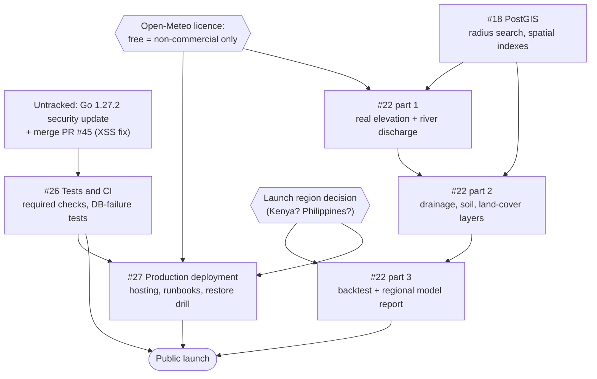

# Roadmap: remaining work and how it fits together

An assessment of everything left before AuraRisk can launch publicly: the four
open issues, how they depend on each other, and work no issue tracks yet. It
reflects the repository on 2026-10-12. Update it as issues close.

**Where things stand:**
- A free demo is live at
  [aurarisk-web.onrender.com](https://aurarisk-web.onrender.com), with the API
  on Render and Postgres on Neon (see [DEPLOYMENT.md](DEPLOYMENT.md)).
- The weather, reports, search and map are all real data; nothing in
  production is mocked.
- The **risk score is the main thing that isn't production-ready**: part of
  it is a placeholder, and it has never been checked against real floods.

## Open issues at a glance

| Issue | Priority | Assessment | Effort* | Blocks public launch? |
|---|---|---|---|---|
| [#26 Tests and CI](https://github.com/iochieng1/Aura-Risk/issues/26) | p0 | **~85% done.** CI runs on every PR; missing: required checks, database-failure tests, and a failing dependency scan | S | Yes (release gate) |
| [#18 PostGIS](https://github.com/iochieng1/Aura-Risk/issues/18) | p1 | **Not started**, but well scoped. Also the foundation for #22's terrain data | M | Indirectly, through #22 |
| [#22 Calibrate the risk score](https://github.com/iochieng1/Aura-Risk/issues/22) | p0 | **Planned, not started.** The biggest and most important item | L | **Yes (release gate)** |
| [#27 Production deployment](https://github.com/iochieng1/Aura-Risk/issues/27) | p0 | **Partly done.** Free demo is live; production hosting, runbooks and restore drills are not | M–L | **Yes (release gates)** |

\* Rough effort for one developer: **S** = a few days, **M** = 1–2 weeks,
**L** = several weeks. Most of #22 is research and data work rather than code.

## How the issues relate

The connections, in words:

- **#18 → #22.** Calibration needs terrain, drainage, soil and land-cover data
  per location. That data is too large to fetch on each request, so it should
  be precomputed and stored in PostGIS, then looked up by location. Doing #18
  first means #22 builds on it rather than working around it.
  *(#22 part 1, real elevation from Open-Meteo, doesn't need PostGIS and can
  start now.)*
- **#22 ↔ #27, through the launch region.** #22's release gate is "a validated
  model report *for each launch region*", and #27's hosting region should be
  close to users. Both depend on one decision that hasn't been made: **where
  AuraRisk launches first.** The map defaults to Manila, but the live demo has
  been used from Kisumu, Kenya. Decide this first; it changes which flood
  records, hazard maps and agencies #22 relies on.
- **#26 → #27.** Production deployment depends on CI for its safety:
  - an image built and tagged per commit makes rollback possible;
  - required checks stop broken code reaching `main`, which Render deploys
    automatically.

  The CI image build added in #50 is the first piece.
- **Open-Meteo's licence → #22 and #27.** The free API is non-commercial only.
  - A **portfolio or pilot** can use it.
  - A **launch run by an organization**, or one earning money, needs a paid
    key or a self-hosted Open-Meteo. That is a cost line in #27, and it
    affects which datasets #22 can use.
- **#18 → #27.** Every hosting option must support PostGIS. All the ones in
  DEPLOYMENT.md do: Neon, RDS and DigitalOcean.

## Issue-by-issue assessment

### #26 Tests and CI (p0): finish first, it's nearly done

**Done:**
- `.github/workflows/ci.yml` runs on every PR. It covers:
  - Go formatting, `go mod tidy`, vet, and race-detector tests including
    Postgres integration tests;
  - the backend Docker image build;
  - the mobile and shared typecheck and tests (66 tests);
  - the web build;
  - Prometheus, Alertmanager, Loki and Alloy config checks;
  - dependency scans.
- Unit tests cover score edge cases, Open-Meteo decoding and failures,
  malformed inputs (including the new client-weather validation), and
  handler errors.

**Left:**
1. **Dependency scan failing on `main`.**
   - `govulncheck` reports 9 Go standard-library advisories affecting the
     code, plus one in `golang.org/x/net` that the code doesn't call.
   - The report lists **Go 1.27.2** and **`golang.org/x/net` v0.60.0** as
     the fixes.
   - This affects the **live demo too**, which is built with
     `golang:1.27.1-alpine`.
   - Fix: bump `go.mod`, the Dockerfile and the module.
   - The job is "report only", which is why it was easy to ignore. Make it
     blocking once it's green.
2. **"Must pass on every PR".** Turn on branch protection for `main`,
   requiring the CI checks. This is a GitHub setting rather than code, and it
   needs the repo owner.
3. **Database-failure tests.** Check that each handler returns a clean 500 or
   503 (not a panic or a hang) when Postgres is down or slow. Readiness
   already reports the database; the request handlers need coverage.
4. **Web tests.** The web app has no test runner; only the build is checked.
   Add Vitest and Testing Library for the states added in #49 (loading,
   error, retry, offline, freshness).

**Acceptance:**
- All jobs are green and required on `main`.
- Database-failure tests exist for the report and risk handlers.

### #18 PostGIS (p1): next code task, unlocks #22

**Today:**
- `GET /api/reports` filters by a rough box: `latDelta = radius / 111` and
  `lonDelta = radius / (111 × 0.9)`. That treats every place as if it were
  near latitude 25°, so the box is the wrong width elsewhere, and its corners
  include reports beyond the radius.
- Duplicate detection uses `services.BoundingBox` plus a distance check.
- Migration 005 adds a plain B-tree index on `(lat, lon)`.

**Plan:**
1. Migration 006: `CREATE EXTENSION postgis`, add a
   `geography(Point, 4326)` column, backfill it from `lat`/`lon`, and add a
   GiST index.
   - Neon supports the extension, so the demo can take it.
   - CI's `postgres:16-alpine` service image doesn't include PostGIS. Switch
     it to a `postgis/postgis` image.
2. Rewrite the reports query and duplicate detection with `ST_DWithin` (true
   radius, correct near the poles and the antimeridian).
3. Keep `lat`/`lon` in the API so clients don't change.
4. Later, for #22: tables for terrain and drainage values, keyed by grid
   cell or polygon.

**Risks:**
- The migration must be reversible, or at least tested on a copy of real data.
- Local Compose and CI need the PostGIS image too.

**Acceptance:**
- Radius results match the old ones for normal cases.
- The query plan uses the spatial index.
- Integration tests pass on the PostGIS image.

### #22 Calibrate the risk score (p0): the core of the product

The full plan is in [RISK_DATA_SOURCES.md](RISK_DATA_SOURCES.md). In short:

**The problem:**
- `terrainFactor` in `internal/services/risk.go` is
  `abs(sin(lat*100) * cos(lon*100)) * 20`. That adds up to 20 of 100 points
  unrelated to the ground.
- Every weight and threshold is hand-picked.
- Confidence is capped at *medium* (`modelCalibrated = false`), and the UI
  says "decision support only". Both are correct until this is done.

**Phases:**
1. **Real inputs (M):**
   - Replace the placeholder with Open-Meteo elevation (and later height
     above the nearest drainage line).
   - Add GloFAS river discharge from the Open-Meteo Flood API.
   - Bump `model_version`.
   - The client-weather fallback (#52) must send the same new inputs, or the
     server fetches the static ones itself. Plan this when changing the
     inputs.
2. **Static layers (M, needs #18):** drainage (MERIT Hydro or HydroSHEDS),
   soil (SoilGrids) and land cover (ESA WorldCover), precomputed into PostGIS.
3. **Backtest and report (L):**
   - Replay historical rainfall (ERA5) over known flood and non-flood days in
     the launch region.
   - Measure detection rate, false-alarm rate and warning lead time.
   - Tune the weights, keeping a held-out set of events that are never used
     for tuning.
   - Publish the regional model report.
   - Only then set `modelCalibrated = true` for that region.

**Risks:**
- **Flood records are the hard part.** Global datasets are coarse; local
  agency data may need requests or partnerships.
- **Small urban floods** (blocked drains) won't appear in river or satellite
  data. Community reports help, but are biased toward busy areas.
- **Expert review.** The release gate expects a domain expert to review the
  model report. Find one early, e.g. a university hydrology department or the
  national meteorological agency.

**Acceptance:**
- No placeholder inputs remain.
- A published model report exists per launch region, with metrics and
  stated limitations.

### #27 Production deployment (p0): demo done, production waits on funding and the region

**Done:**
- Backend Dockerfile, built in CI.
- `render.yaml` free deployment (Render + Neon), live and verified.
- Production options written up in [DEPLOYMENT.md](DEPLOYMENT.md): AWS
  Singapore recommended, DigitalOcean as a cheaper MVP.
- Monitoring stack and on-call runbooks in [ON_CALL.md](ON_CALL.md).
- The Open-Meteo shared-IP problem is solved for the demo by the
  device-weather fallback (#52).

**Left:**
1. **Pick the launch region first.**
   - The docs assume Singapore for a Philippines launch.
   - For **Kenya / East Africa**, choose the nearest region your provider
     offers, often in Europe or South Africa, and compare latency.
2. **Immutable releases:** CI pushes images tagged with the commit SHA to a
   registry. Deploy a tag, and roll back by redeploying the previous one.
3. **Infrastructure as code** (Terraform or similar) for the chosen provider.
4. **Release gate: incident and rollback runbook.** ON_CALL.md covers alerts;
   add deploy, rollback and "the database is gone" procedures.
5. **Release gate: restore drill.**
   - Restore a backup into a scratch database and check it.
   - Record the date and time taken; repeat it on a schedule.
   - Neon's free tier has point-in-time restore for a short window, so the
     drill can be practised on the demo.
6. **Production monitoring:** send metrics and logs to Grafana Cloud (free
   tier) instead of the local-only stack.
7. **Weather licence:** decide between a paid Open-Meteo key and a
   self-hosted instance before an organization runs it.

**Acceptance:**
- HTTPS behind a proper load balancer or gateway.
- Image-tag deploys with a tested rollback.
- Runbooks written, and a restore drill recorded.

## Work no issue tracks yet

Found during this assessment. Each is worth an issue, so nothing is forgotten.

| Item | Why it matters | Effort |
|---|---|---|
| **Upgrade to Go 1.27.2 and `x/net` v0.60.0** | Fixes the 9 standard-library advisories above, including in the **live** API | S |
| **Merge [PR #45](https://github.com/iochieng1/Aura-Risk/pull/45)** (stored XSS fix in map popups, maplibre-gl v6) | A **security fix** open since 2026-10-08. It still merges cleanly into `main` and its CI passed | S |
| **Open-Meteo attribution in the UI** | Open-Meteo data is CC BY 4.0 and must be credited; the map credits OpenStreetMap but not the weather data | S |
| **Check `client_ip` on Render** | Confirm `TRUSTED_PROXIES` applied, so visitors don't share one rate limit | S |
| **Moderation on the demo** | `MODERATOR_TOKENS` is unset, so the moderation API is off and test reports can't be removed through the API | S |
| **`GET /api/risk` range check** | Unlike `POST /api/risk`, it doesn't reject latitude/longitude outside ±90/±180 | S |
| **Location names** | The backend doesn't geocode, so the risk summary always says "Flood risk for Selected Location…". The shared client replaces `location.name`, but not the summary text the card shows | S |
| **Default map centre** | Manila; change it to match the launch region | S |
| **Mobile follow-ups** (from the #31/#32 review) | Queued reports are dropped **silently** after 3 failed retries; the offline cache is never evicted; no tests for the cache, push setup, background refresh or photo upload | M |
| **Client-weather trust** | The device-weather fallback validates data but can't prove it's genuine. That's fine because it only affects the caller's own result. Keep it that way: never cache it, alert from it, or store it | — |

## Release gates: status

From [ARCHITECTURE.md](ARCHITECTURE.md#recommended-release-gates):

| Gate | Status |
|---|---|
| Validated model report per launch region | ❌ #22 |
| No default production credentials | ✅ |
| HTTPS and abuse-protected report submission | ✅ demo (Render HTTPS; rate limits, validation, moderation). Production: #27 |
| Automated tests and CI passing | 🟡 CI runs; dependency scan failing, checks not required (#26) |
| Database backup and restore verification | ❌ #27 |
| Weather caching, timeout, fallback, freshness indicators | ✅ (#41, #49, #52) |
| Monitoring dashboards and on-call ownership | 🟡 built and documented; not running for the demo (#27) |
| Documented incident and rollback procedure | 🟡 alert runbooks exist; deploy and rollback steps don't (#27) |
| "Decision support" UI language | ✅ (#49) |

## Recommended order

| Phase | Work | Why now |
|---|---|---|
| **0: quick wins** | Merge PR #45 · Go 1.27.2 upgrade · Open-Meteo attribution · check `client_ip` · branch protection | Security and licence fixes; each takes about an hour |
| **1: decide** | Choose the launch region | Shapes #22's data and #27's hosting |
| **2: foundations** | #26 database-failure tests and web tests · #22 part 1 (real elevation + river discharge) | Removes the placeholder quickly; small and visible |
| **3: spatial** | #18 PostGIS | Unlocks #22's static layers and fixes radius search |
| **4: calibrate** | #22 parts 2–3: layers, backtest, model report | The release gate that makes the score trustworthy |
| **5: launch infrastructure** | #27 production hosting, runbooks, restore drill, licence decision | Needs the region, and funding or credits |

For a **portfolio**, phases 0–2 give the biggest gain: the demo becomes
secure, properly credited and placeholder-free, and that work makes good
interview material. Phases 4–5 only matter for a real public launch.
